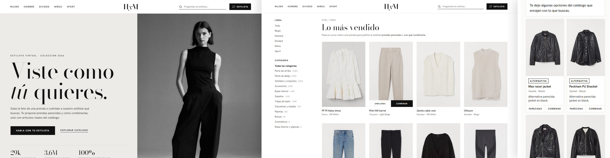

# HyM · Estilista virtual con IA

HyM es un estilista virtual que recibe la foto de una prenda, un mensaje o ambos, y responde con prendas del catálogo de
H&M parecidas a la que buscas y con otras que combinan con ella. Une tres piezas, que son la búsqueda por imagen y texto con
Fashion-CLIP, el filtrado colaborativo a partir de compras reales y un modelo de lenguaje multimodal que interpreta la
petición y explica las recomendaciones sin inventar productos.

Proyecto de la materia de Datos Masivos del Instituto de Investigaciones en Matemáticas Aplicadas y en Sistemas (IIMAS),
UNAM.

**Autores.** Angel Noel Pérez Martínez, Valentina Ayelen Cruz Mendoza e Isaac Monroy Villegas.

📄 El reporte completo está en [`reports/reporte_final.pdf`](reports/reporte_final.pdf).



## Resultados principales

| Componente | Métrica | Resultado |
|---|---|---|
| Predicción de compras (fusión de señales) | MAP@12 | **0.0281**, un 7.7 % mejor que el mejor baseline (0.0261) |
| Búsqueda de texto a imagen (Fashion-CLIP) | Tipo y color correctos entre los 10 primeros | **88 %** y **88 %** (al azar, menos de 10 %) |
| Complementos por co-compra | Recall@12 de co-compras reales | **0.105**, contra 0.075 de la popularidad |
| Chat estilista | Artículos que cumplen la petición | **97 %**, sin ningún artículo inventado |
| Latencia de la recuperación | Por turno, en CPU | Menos de 0.4 segundos sin contar el modelo de lenguaje |

## Cómo funciona

```
Foto y/o mensaje
   │
   ├─► Análisis de imagen ── Fashion-CLIP (vector, ¿es moda?) + modelo de visión (tipo, color, estilo)
   ├─► Planificador ──────── el modelo de lenguaje llena campos fijos y el código los valida
   │
   ├─► Similares ─────────── búsqueda exacta sobre los embeddings de 28,966 artículos disponibles
   ├─► Complementos ──────── co-compras reales + reglas de outfit
   │
   └─► Redactor ──────────── el modelo de lenguaje explica citando solo artículos recuperados
                             y el código elimina cualquier artículo o marca inventados
```

El modelo de lenguaje nunca decide qué prendas mostrar. Solo entiende el mensaje y redacta la respuesta, mientras que la
selección la hacen componentes que se pueden medir. Esa es la razón de que el chat no invente productos.

## Estructura del repositorio

```
hm-stylist/
├── notebooks/          # una fase del proyecto por notebook, ya ejecutados con sus resultados
│   ├── 01-eda-dmii.ipynb              análisis exploratorio y partición temporal
│   ├── 02-baselines.ipynb             popularidad, recompra y ALS
│   ├── 03-embeddings.ipynb            embeddings de Fashion-CLIP e índice vectorial
│   ├── 04-complementary.ipynb         complementos por co-compras
│   ├── 05-ranking.ipynb               fusión de señales y re-ranking
│   ├── 06-rag-y-chat-estilista.ipynb  chat con RAG y su evaluación
│   └── 07-exportar-demo.ipynb         paquete de datos para la aplicación
├── src/                # código del estilista, compartido por los notebooks y la aplicación
│   ├── data.py         carga de artefactos y catálogo disponible
│   ├── embeddings.py   Fashion-CLIP y detector de imágenes de moda
│   ├── ranking.py      búsqueda de similares y complementos
│   ├── llm.py          cliente para cualquier servidor compatible con la API de OpenAI
│   └── stylist.py      lógica de cada turno de la conversación
├── app/                # aplicación web (FastAPI + HTML/CSS/JS)
├── kaggle/             # configuración para ejecutar los notebooks en Kaggle con su CLI
└── reports/            # reporte final y figuras
```

## Datos

Usamos el dataset público de la competencia [H&M Personalized Fashion Recommendations](https://www.kaggle.com/competitions/h-and-m-personalized-fashion-recommendations)
de Kaggle, con 105,542 artículos, 1.37 millones de clientes y 31.8 millones de transacciones. El dataset pesa decenas de
gigabytes, así que no está en el repositorio. Los notebooks se ejecutan en Kaggle y cada uno usa como entrada la salida de
los anteriores.

## Reproducir los resultados

Los notebooks se corren en orden en Kaggle, agregando como input la competencia y las salidas de los notebooks previos.

| Notebook | Necesita | Tiempo aproximado |
|---|---|---|
| 01 | Competencia | 5 min |
| 02 | 01 | 5 min |
| 03 | Competencia, 01, GPU e Internet | 20 min |
| 04 | 01, 03 | 5 min |
| 05 | Competencia, 01 a 04, Internet | 15 min |
| 06 | Competencia, 01, 03, 04, `src/`, GPU e Internet | 12 min |
| 07 | Competencia, 01, 03, 04, 06, `src/` | 10 min |

Los notebooks 05 a 07 también se pueden lanzar desde una computadora con el CLI de Kaggle. Los pasos están en
[`kaggle/README.md`](kaggle/README.md).

## Ejecutar la aplicación

La aplicación corre de forma local y necesita tres cosas, que son este repositorio, el paquete `hm-demo-data.zip` que genera
el notebook 07 (494 MB) y un servidor de modelos de lenguaje compatible con la API de OpenAI, como Lemonade u Ollama, con un
modelo que acepte imágenes.

```bash
python -m venv .venv && source .venv/bin/activate
pip install torch --index-url https://download.pytorch.org/whl/cpu
pip install -r app/requirements.txt
unzip hm-demo-data.zip -d ~                     # crea ~/hm-demo-data

# Configuración del modelo de lenguaje (ejemplo con Lemonade y Qwen3.6)
export LLM_BASE_URL=http://localhost:13305/v1
export LLM_MODEL=Qwen3.6
./app/run.sh                                    # abre http://localhost:8000
```

Si el modelo de lenguaje no está disponible, la aplicación sigue funcionando en modo básico, con búsqueda por imagen,
complementos y filtros, pero sin la explicación del estilista.

## Aviso

HyM es un proyecto académico. Las imágenes y los datos de producto provienen del dataset público de H&M en Kaggle y el
proyecto no tiene relación con H&M. Las fuentes tipográficas (Hanken Grotesk y Bodoni Moda) se distribuyen con licencia SIL
Open Font License.
